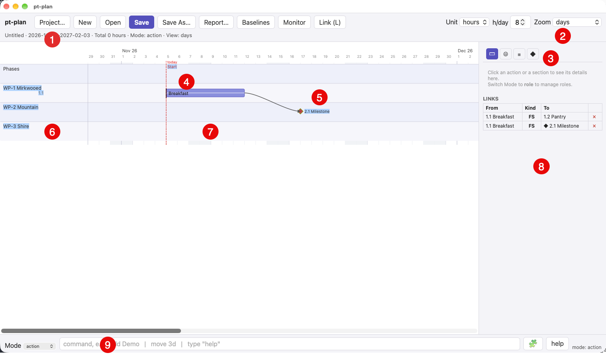
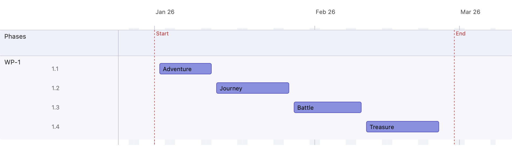

# 1 · Getting started

This walkthrough creates a plan from scratch and places a handful of actions on
the timeline.

## Overview

From left to right, up to down.

Marker | Short    | Description
:------|:---------|:-----------
①     | Project   | Detail dialog for project settings 
②     | Zoom      | Views zoom in at different levels. 
③     | Mode      | Switch to a different object view in the right pane. 
④     | Action    | Core object of plans
⑤     | Milestone | A point in time, also called a gate 
⑥     | Section   | The right side of the horizontal lane
⑦     | Work Package | The left side of the horizontal lane
⑧     | Right pane   | Object details
⑨     | CLI       | Command line interface

## Steps

1. **New plan.** Start with an empty plan (toolbar **New**). A fresh plan is
   titled *Untitled* and seeds its window to today plus 90 days.
2. **Name and configure it.** Open the project dialog and give the plan a name
   (*Journey*). Choose the estimation **unit** (*days*) and the hours per day
   (8). Effort is always stored unit-independently, so switching the unit later
   never reinterprets a stored value.
3. **Set the project window.** The plan has an overall **Start** and **End**
   (the red dashed *Start* / *End* markers). They bound the visible timeline.
   Here the window is 1 Jan – 28 Feb 2026.
4. **Add actions.** Add four actions, each with a start and end date:

   | # | Action | Start | End |
   |---|--------|-------|-----|
   | 1.1 | Adventure | 2026-01-02 | 2026-01-12 |
   | 1.2 | Journey   | 2026-01-13 | 2026-01-27 |
   | 1.3 | Battle    | 2026-01-28 | 2026-02-10 |
   | 1.4 | Treasure  | 2026-02-11 | 2026-02-25 |

5. **Fit to window.** Set the zoom selector to **Window** so the whole plan
   fills the canvas.

## Result

Things to notice:

- The left column lists **swimlanes**. The locked **Phases** lane is always
  first and carries no number; the default work-package lane is **WP-1**.
- Each action gets a dense **WBS number** (`1.1`, `1.2`, …) computed per render.
- The red dashed lines mark the project **Start** and **End**; the lighter
  dashed line (when today falls inside the window) marks **today**.
- Drag a bar horizontally to move it in time, or grab an edge to resize it.
  Drag a bar vertically to move it to another lane.

Next: [Sections & colours →](02-sections-and-colours.md)
