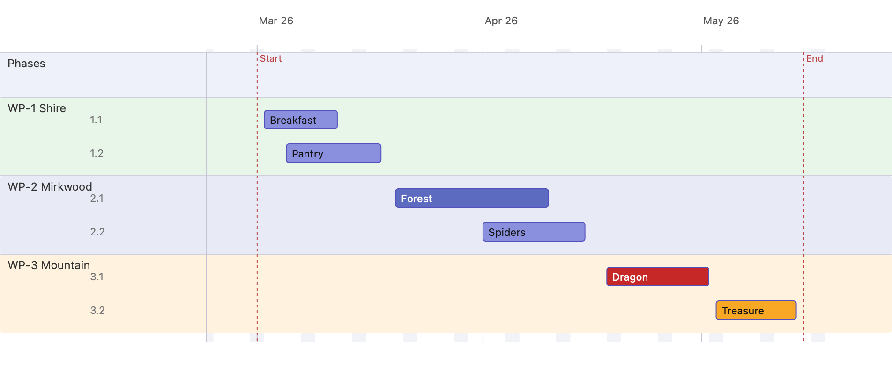

# 2 · Sections & colours

Sections (swimlanes) group related actions, and both sections and individual
action bars can carry their own colour.

## Exercise Sections and actions

  - Click in the Command Line Interface ⑨
  - Press Command - s  to get into section mode
  - "select 3" <enter> select the section number 3
  - Press Command - a to get into action mode
  - "add action Breakfast" <enter> creates the action "Breakfast"

## Exercise color
  - Select a section with left click
  - Click on color in right pane ⑧
  - Choose a color

## Exercise zoom
  - Select zoom pulldown ②
  - Choose "Window (fit)
  - Choose a color

## Steps

1. **Create sections.** Add three named sections: **Shire**, **Mirkwood**,
   **Mountain**. A section appears as a swimlane as soon as it exists, even
   while empty.

   **Exercise**
  - Click in the Command Line Interface ⑨
  - Press Command - s  to get into section mode
  - "add section Shire" <enter> creates the section "Shire"

2. **Add actions into the sections.** Add the actions and assign each to a
   section (drag it onto the lane, or set its section):

   | Section | Actions |
   |---------|---------|
   | Shire    | Breakfast, Pantry |
   | Mirkwood | Forest, Spiders |
   | Mountain | Dragon, Treasure |

3. **Colour the sections.** Give each lane a soft background tint — Shire green,
   Mirkwood blue, Mountain amber — so the groups read at a glance.

4. **Colour individual bars.** Override a few bar colours: *Forest* indigo,
   *Dragon* red, *Treasure* yellow. Label text automatically switches between
   black and white for contrast (note the white "Dragon" on red).
5. **Fit to window** to frame the whole plan.

## Result

Things to notice:

- Lanes are labelled **WP-1 Shire**, **WP-2 Mirkwood**, **WP-3 Mountain** and
  sorted by work-package number; **Phases** stays on top with no number.
- Within a section, actions keep a two-level **WBS number** (`1.1`, `1.2`,
  `2.1`, …).
- Section tints sit behind the bars; explicit bar colours win over the section
  colour. Empty sections still render as a lane.
- The label colour (`Dragon` in white) is chosen automatically from the bar's
  brightness, or you can set it explicitly.

Next: [Roles & assignments →](03-roles-and-assignments.md)
