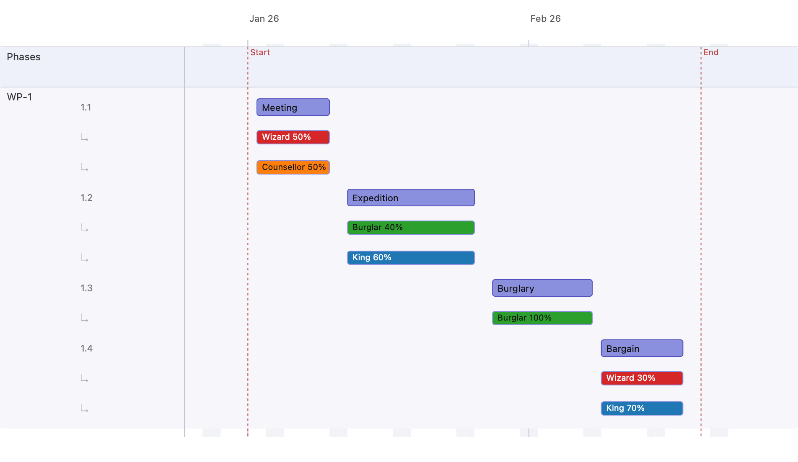

# 3 · Roles & assignments

Roles are the people (or job functions) working the plan. Each role has a
distinct colour, and each action can be shared between several roles by
percentage.

## Exercise add role

- Click in the Command Line Interface ⑨
- Press Command - r  to get into role mode
- "add role Wizard" <enter> creates the role "Wizard"

## Exercise apply role

- Select action ④
- Click "Edit" in right pane ⑧
- in the Roles pulldown select a role and a percentage
- Scroll down and click "Apply"
- Click "Close"

## Exercise show role

- Click "Role" icon ☺ in mode headline ③ from right pane ⑧ 
- Activate "Show role actions"

## Steps

1. **Add roles.** Create the company's roles. Each role records a description —
   here, the actor who plays the part:

   | Role | Played by |
   |------|-----------|
   | Wizard | Gandalf |
   | Burglar | Bilbo |
   | King | Thorin |
   | Counsellor | Balin |

   New roles are given a distinct palette colour (duplicate colours are
   rejected).

2. **Add actions.** Add *Meeting*, *Expedition*, *Burglary*, *Bargain*.
3. **Assign roles to actions.** Each assignment is a role plus its percentage
   share of that action's effort. A role's percentage is the fraction of the
   working day it spends on the action.

   | Action | Assignments |
   |--------|-------------|
   | Meeting | Wizard 50%, Counsellor 50% |
   | Expedition | King 60%, Burglar 40% |
   | Burglary | Burglar 100% |
   | Bargain | King 70%, Wizard 30% |

4. **Turn on role sub-rows** 
   switch the view to **role** mode.

## Result

Things to notice:

- In **role** mode each action bar is followed by one **sub-row per assigned
  role** (the `↳` rows), drawn in the role's own colour and labelled with its
  percentage (e.g. *Wizard 50%*, *King 60%*).
- The same role may appear on several actions (here *King* and *Wizard* both
  recur), each with its own share.
- A role's capacity is checked against the action window; an over-committed
  action is flagged with a red border (see
  [Dependencies & milestones](04-dependencies-and-milestones.md) for warnings).

Next: [Dependencies & milestones →](04-dependencies-and-milestones.md)
