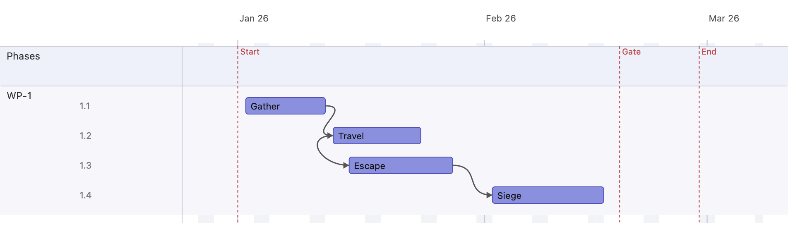
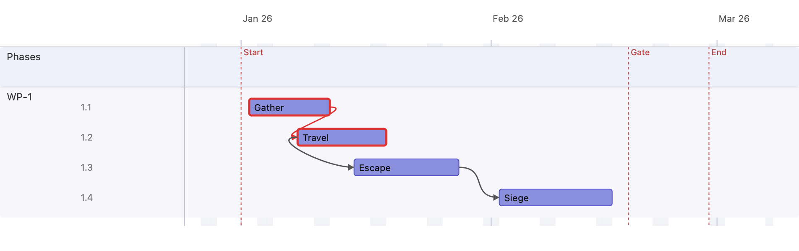

# 4 · Dependencies & milestones

Actions can be linked with typed dependencies, and milestones mark fixed points
in the plan. pt-plan checks each link and flags the ones that are violated.

## Link types

| Kind | Meaning | Rule (A → B) |
|------|---------|--------------|
| FS | Finish → Start | B starts no earlier than A finishes |
| SS | Start → Start | B starts no earlier than A starts |
| FF | Finish → Finish | B finishes no earlier than A finishes |
| SF | Start → Finish | B finishes no earlier than A starts |

## Exercise milestone

  - Select a Work Package by clicking the left part of a section ⑥
  - Right click in the right part of the Work Package section ⑦
  - Choose "New Milestone" in Menu
  - Click "Save" Button in the right pane ⑧

## Exercise link

  - Hover over an action ④, do not click
  - 2 Anchorpoints occure
  - click and draw from one of the points to another action
  - the left, right, up, down nodes represent different link kinds

## Steps

1. **Add actions** *Gather*, *Travel*, *Escape*, *Siege*.
2. **Add a milestone** *Gate* at 18 Feb (a milestone is a zero-duration marker).
3. **Link them.** Draw the dependencies — select an action, press **L**, then
   click the target, or drag between the hover anchors on the bar edges. The
   anchors you use decide the kind (left↔left = SS, right↔right = FF, …):

   | Link | Kind |
   |------|------|
   | Gather → Travel | FS |
   | Travel → Escape | SS |
   | Escape → Siege | FS |

## Result — satisfied links

The arrows route from the anchor you linked from, and the **Gate** milestone
shows as a dashed vertical marker.

## Introduce a violation

Now move *Travel* so it starts **before** *Gather* finishes. The `Gather → Travel`
Finish-Start link is now broken.

Things to notice:

- The **violated link turns red**, and both actions on it get a **red warning
  border**, so a scheduling conflict is obvious at a glance.
- Warnings are a **visual-editor aid only** — they never appear in the exported
  PDF/PNG report.
- Milestones can also be linked (a point-to-point link), except full-height
  milestones such as the project Start/End.

Next: [Details, notes & report →](05-details-notes-and-report.md)
