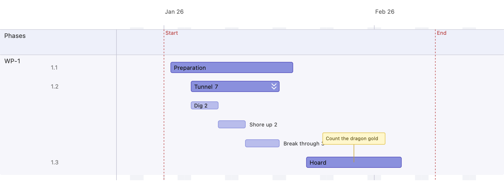
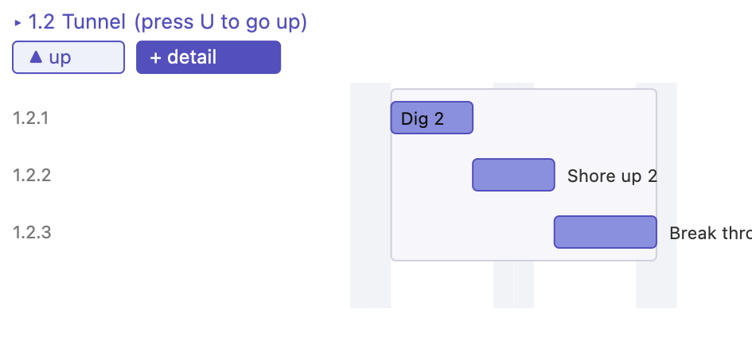
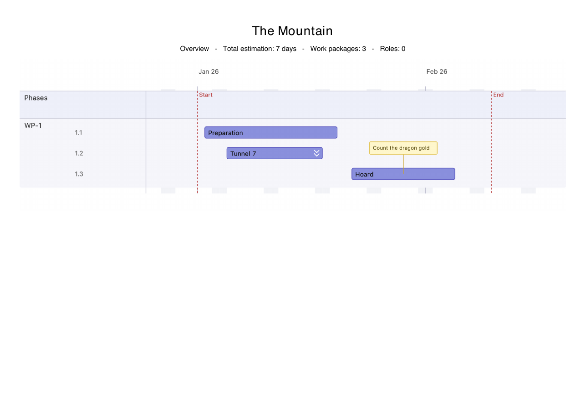
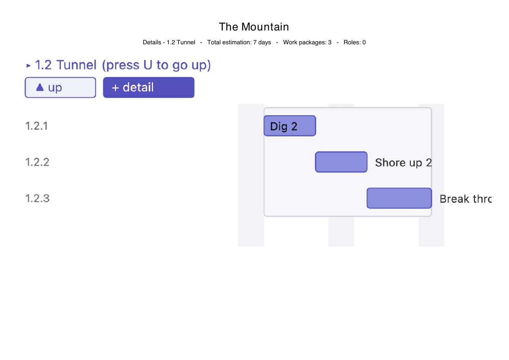

# 5 · Details, notes & report

An action can be broken down into a third level of **detail** tasks, annotated
with a sticky **note**, and the whole plan can be exported to a **PDF report**.

## Steps

1. **Add actions** *Preparation*, *Tunnel*, *Hoard*.
2. **Give an action details.** Add three detail tasks to *Tunnel*:

   | # | Detail | Start | End |
   |---|--------|-------|-----|
   | 1.2.1 | Dig | 2026-01-05 | 2026-01-09 |
   | 1.2.2 | Shore up | 2026-01-09 | 2026-01-13 |
   | 1.2.3 | Break through | 2026-01-13 | 2026-01-18 |

3. **Add a note.** Give *Hoard* a description (*Count the dragon gold*) and turn
   its note on, positioned above the bar.
4. **Show detail bars** (*Show details* in the project dialog) so the details
   appear inline under their parent.

## Result — the main canvas

- *Tunnel* carries a **drill icon** (the double chevron at the bar's right
  edge); its detail bars (*Dig*, *Shore up*, *Break through*) show indented
  beneath it.
- *Hoard* has a yellow **sticky note** connected to the bar.

## Drill in

Click the drill icon (or double-click the summary) to open the **detail plane**
for *Tunnel* — a focused timeline bounded by the action's own window, where the
details become first-class draggable bars.

Use **+ detail** to add another, and **▲ up** (or the `U` key) to return.
The actions in detail pane only have one role. That is a design decision to prevent to many levels of detail

## Export a report

Finally, export the plan to a **PDF report** (toolbar **Report…**). The report
always prints the details: a whole-project **overview** page, then a separate
page for **each action that has details**. The report image is the live canvas,
so it matches the screen (notes, arrows, headers), and each page's orientation
is chosen to fit the image.

Overview page (details compacted):

Per-action detail page (here *1.2 Tunnel*):

The report continues with a work-package table and a per-role breakdown (not
shown).

Back to the [walkthrough index](README.md).
